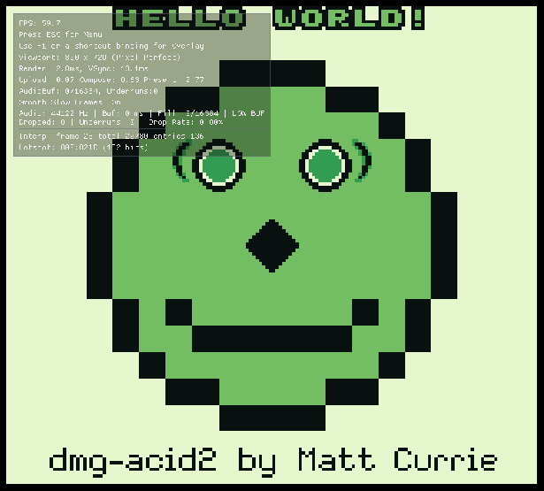

# TetrisGBRecomp para macOS

Recompilación estática de **Tetris (Game Boy)** a un ejecutable **nativo de macOS**.
Es un fork de [TetrisGBRecomp](docs/README-original.md) adaptado para Mac con
procesador **Intel**. El equipo de referencia es un **MacBook Pro 16" 2019**
(Core i9 de 8 núcleos a 2.3 GHz, Intel UHD Graphics 630).

> **¿Qué es esto?** No es un emulador. El código máquina original del Game Boy
> se **traduce a C** en tu Mac y luego se compila como un programa nativo. El
> resultado es un `Tetris` que corre directamente en macOS.

---

## Índice

1. [Por qué hacía falta adaptarlo](#1-por-qué-hacía-falta-adaptarlo)
2. [Requisitos](#2-requisitos)
3. [Resumen rápido (para expertos)](#3-resumen-rápido-para-expertos)
4. [Guía paso a paso](#4-guía-paso-a-paso)
5. [Controles](#5-controles)
6. [Uso diario y actualizaciones](#6-uso-diario-y-actualizaciones)
7. [Solución de problemas](#7-solución-de-problemas)
8. [Detalles técnicos del parche](#8-detalles-técnicos-del-parche)
9. [Cómo se probó](#9-cómo-se-probó)
10. [Estructura del repositorio](#10-estructura-del-repositorio)
11. [Créditos y licencias](#11-créditos-y-licencias)

---

## 1. Por qué hacía falta adaptarlo

El motor ([`gb-recompiled`](https://github.com/mstan/gbrecompiled)) y su
launcher ([`recomp-ui`](https://github.com/mstan/recomp-ui)) dibujan todo con
**OpenGL ES 2.0**. En Windows eso funciona porque se distribuye **ANGLE** junto
al `.exe`. Pero **macOS no incluye OpenGL ES**, solo OpenGL "de escritorio".
Sin cambios, el juego compilaría en Mac pero fallaría al abrir la ventana.

Este fork añade un parche (`macos/patches/gb-recompiled-opengl-core.patch`) que,
**solo en macOS**, hace tres cosas:

- crea un contexto **OpenGL 3.2 Core**, el que Apple soporta;
- traduce los shaders de GLSL ES 1.00 a **GLSL 1.50** al compilarlos;
- usa el backend de escritorio de Dear ImGui y la ruta de escritorio del launcher.

Windows y Linux siguen funcionando exactamente igual que antes.

---

## 2. Requisitos

| Requisito | Detalle |
|---|---|
| Mac | Intel (x86_64). Probado como objetivo: MacBook Pro 16" 2019. |
| macOS | Una versión reciente que Homebrew siga soportando. Conviene tener tu Mac actualizado. |
| Espacio libre | ~1.5 GB (herramientas, código fuente y compilación). |
| Internet | Solo durante la instalación. |
| Herramientas | Xcode Command Line Tools y Homebrew. La guía explica cómo instalarlas. |
| **ROM** | **Tu propio volcado** de *Tetris (World) V1.0*. **No se incluye** ni se descarga. |

### La ROM correcta

| Campo | Valor |
|---|---|
| Nombre habitual | `Tetris (World)` / `Tetris (W) (V1.0) [!].gb` |
| Tamaño | 32,768 bytes (32 KB) |
| CRC32 | `63F9407D` |
| SHA-1 | `3f2a6407c9900ad5817ee1cfb3609c5ee17400fc` |

La revisión **V1.1** (`Tetris (JUE) (V1.1) [!]`, CRC32 `46DF91AD`) **no sirve**.
Es un programa distinto y el código recompilado corresponde a la V1.0.

---

## 3. Resumen rápido (para expertos)

```bash
xcode-select --install
```

```bash
git clone https://github.com/gabom88/TetrisGBRecomp-MAC.git
```

```bash
cd TetrisGBRecomp-MAC
```

```bash
./macos/setup.sh
```

```bash
cp ~/Downloads/"Tetris (World).gb" roms/tetris.gb
```

```bash
./macos/build.sh
```

```bash
./macos/run.sh
```

Se asume que Homebrew ya está instalado. Si no, sigue la guía completa.

---

## 4. Guía paso a paso

### Paso 0 — Abrir la Terminal

Pulsa `⌘ Cmd + Espacio`, escribe **Terminal** y pulsa `Return`. Todos los
comandos de esta guía se pegan ahí; ejecuta cada uno con `Return`.

> Cada bloque de código es **un solo comando**. Cópialos de uno en uno.

### Paso 1 — Instalar Xcode Command Line Tools

Son el compilador (Clang), `git` y `make` de Apple.

```bash
xcode-select --install
```

- Aparecerá una ventana: pulsa **Instalar** y acepta la licencia (5–15 minutos).
- Si dice *"command line tools are already installed"*, ya los tienes: sigue al paso 2.

Comprobación (debe mostrar una ruta, sin errores):

```bash
xcode-select -p
```

### Paso 2 — Instalar Homebrew

Homebrew es el gestor de paquetes que instalará `cmake`, `ninja` y `SDL2`.

Comprueba si ya lo tienes:

```bash
brew --version
```

Si dice `command not found`, instálalo con el comando oficial de
[brew.sh](https://brew.sh):

```bash
/bin/bash -c "$(curl -fsSL https://raw.githubusercontent.com/Homebrew/install/HEAD/install.sh)"
```

Te pedirá tu contraseña de usuario de macOS (no se ve mientras la escribes; es
normal). En un Mac **Intel** Homebrew se instala en `/usr/local` y queda listo
para usar sin pasos extra. Cierra y vuelve a abrir la Terminal, y comprueba:

```bash
brew --version
```

### Paso 3 — Descargar este repositorio

Elige dónde guardarlo. Por ejemplo, en tu carpeta personal:

```bash
cd ~
```

```bash
git clone https://github.com/gabom88/TetrisGBRecomp-MAC.git
```

```bash
cd TetrisGBRecomp-MAC
```

> No hace falta `--recursive`: el script del paso 4 descarga las dependencias en
> la versión exacta que necesitan.

### Paso 4 — Preparar todo con `setup.sh` (solo la primera vez)

```bash
./macos/setup.sh
```

El script muestra el progreso en 5 pasos:

| Paso | Qué hace |
|---|---|
| 1/5 | Comprueba que existen Xcode Command Line Tools y Homebrew. |
| 2/5 | Instala con Homebrew **solo lo que falte** de `cmake`, `ninja` y `sdl2`. |
| 3/5 | Descarga `gb-recompiled` y `recomp-ui` **en los commits exactos** con los que se validó Tetris, dentro de este repo. |
| 4/5 | Aplica el parche de OpenGL Core para macOS. |
| 5/5 | Compila el recompilador `gbrecomp`. |

Al final verás `==> Listo.` Puedes ejecutarlo otra vez sin riesgo: detecta lo
que ya está hecho y se lo salta.

> ⏳ **Mac Intel: el paso 2/5 puede tardar 15–40 minutos.** Homebrew ya no
> publica paquetes precompilados para Intel, así que **compila CMake y SDL2 en tu
> Mac**. Verás una línea como `==> ./bootstrap --prefix=/usr/local/Cellar/cmake/…`
> que parece congelada: **no lo está**. En el *Monitor de Actividad* verás
> procesos `clang`/`make` usando CPU. No cierres la Terminal.
>
> El aviso *"A newer Command Line Tools release is available"* es solo
> informativo; no impide la instalación.
>
> **Atajo opcional:** instala CMake con el `.dmg` oficial de
> [cmake.org/download](https://cmake.org/download/) (arrástralo a Aplicaciones y
> ejecuta `sudo "/Applications/CMake.app/Contents/bin/cmake-gui" --install`).
> Así `setup.sh` ve que ya existe `cmake` y no lo compila.

> Si responde `permission denied`, da permisos a los scripts con
> `chmod +x macos/*.sh` y repite.

### Paso 5 — Copiar tu ROM

La ROM debe llamarse **exactamente** `tetris.gb` y estar dentro de la carpeta
`roms/` del repo. Esa carpeta no viene en el repo (está en `.gitignore`), así que créala:

```bash
mkdir -p roms
```

Cópiala, por ejemplo desde Descargas (ajusta el nombre a tu archivo):

```bash
cp ~/Downloads/"Tetris (World).gb" roms/tetris.gb
```

También puedes arrastrarla con el Finder: abre la carpeta con `open roms` y
renombra el archivo a `tetris.gb`.

Comprobación opcional (debe mostrar `3f2a6407c9900ad5817ee1cfb3609c5ee17400fc`):

```bash
shasum -a 1 roms/tetris.gb
```

### Paso 6 — Recompilar y compilar con `build.sh`

```bash
./macos/build.sh
```

| Paso | Qué hace |
|---|---|
| 1/4 | Verifica el SHA-1 de tu ROM; si no es la V1.0, se detiene y te lo explica. |
| 2/4 | **Traduce la ROM a C** (`gbrecomp --config tetris.toml`) en la carpeta `generated/`. |
| 3/4 | Configura el proyecto en modo Release con **OpenGL Core**. |
| 4/4 | Compila con Clang y Ninja usando los 8 núcleos (1–3 minutos en un i9). |

Al terminar verás `==> Listo: generated/build/Tetris`.

### Paso 7 — ¡Jugar!

```bash
./macos/run.sh
```

1. Se abre el **launcher** (pantalla "GAME BOY · Tetris").
2. Si te pide la ROM, pulsa **Browse For ROM** / **Change ROM** y elige `roms/tetris.gb`.
   El launcher mostrará **✓ ROM verified**. La ruta se guarda en
   `generated/build/rom.cfg` y no te lo volverá a pedir.
3. Pulsa **PLAY** (o `Return`).
4. Opcional: marca **Skip launcher on boot** para entrar directo al juego la próxima vez.

> **Seguridad de macOS:** al compilarlo tú mismo, el programa no lleva la marca
> de "descargado de Internet", así que Gatekeeper normalmente **no** lo bloquea.
> Si macOS pregunta si el programa puede *aceptar conexiones entrantes*, puedes
> responder **Denegar**: es un servidor de depuración local (`127.0.0.1:4370`) que
> no hace falta para jugar.

---

## 5. Controles

| Game Boy | Teclado del Mac |
|---|---|
| Cruceta | Flechas |
| A | `Z` |
| B | `X` |
| Start | `Return` |
| Select | `Shift` derecho |

| Atajo | Acción |
|---|---|
| `F1` | Overlay de recomp-ui: ajustes, vídeo, controles. |
| `Tab` (mantener) | Turbo / avance rápido. |
| `Esc` | Menú. |

> **MacBook Pro 16" 2019 con Touch Bar:** para pulsar `F1` mantén **`fn`**, o
> configura *Ajustes del Sistema → Teclado → Touch Bar muestra → Teclas F*.

Los controles se reasignan desde el overlay (`F1`) o editando
`generated/build/keybinds.ini`. Los mandos compatibles con SDL2 (PS4, PS5, Xbox,
Switch Pro) deberían detectarse automáticamente.

---

## 6. Uso diario y actualizaciones

Para jugar, desde la carpeta del repo:

```bash
cd ~/TetrisGBRecomp-MAC
```

```bash
./macos/run.sh
```

### Crear un icono para el Escritorio (opcional)

Crea un archivo `.command` que se abre con doble clic:

```bash
printf '#!/bin/bash\nexec "%s/macos/run.sh"\n' "$PWD" > ~/Desktop/Tetris.command
```

```bash
chmod +x ~/Desktop/Tetris.command
```

### Actualizar el repo y recompilar

```bash
git pull
```

```bash
./macos/setup.sh
```

```bash
CLEAN=1 ./macos/build.sh
```

`CLEAN=1` borra `generated/` y regenera todo desde cero. Hacerlo así no tiene
ningún riesgo.

### Variables opcionales de `build.sh`

| Variable | Efecto |
|---|---|
| `CLEAN=1` | Borra `generated/` antes de compilar. |
| `SKIP_ROM_CHECK=1` | No comprueba el SHA-1 (no recomendado). |
| `GAME_TOML=archivo.toml` | Usa otra configuración del recompilador. |

---

## 7. Solución de problemas

| Síntoma | Causa probable | Solución |
|---|---|---|
| `xcrun: error: invalid active developer path` | Faltan las Command Line Tools (a menudo tras actualizar macOS). | `xcode-select --install` |
| Se queda mucho tiempo en `==> ./bootstrap … cmake` | Homebrew compila CMake desde el código fuente (Mac Intel). | Espera (10–30 min) o usa el atajo del `.dmg` oficial del [paso 4](#paso-4--preparar-todo-con-setupsh-solo-la-primera-vez). |
| `brew: command not found` | Homebrew no está instalado o la Terminal no se reinició. | Paso 2 y abre una Terminal nueva. |
| `permission denied: ./macos/setup.sh` | Los scripts perdieron el permiso de ejecución. | `chmod +x macos/*.sh` |
| `La ROM no es Tetris (World) V1.0` | Tienes la V1.1 u otra variante. | Usa un volcado con el SHA-1 de la [sección 2](#la-rom-correcta). |
| `No encuentro roms/tetris.gb` | Nombre o carpeta incorrectos. | El archivo debe ser exactamente `roms/tetris.gb`. |
| `El parche no aplica…` | Se modificó a mano la carpeta `gb-recompiled/`. | `git -C gb-recompiled checkout -- .` y repite `./macos/setup.sh`. |
| `Could not find a package configuration file provided by "SDL2"` | SDL2 no está instalado. | `brew install sdl2` y repite `./macos/build.sh`. |
| Ventana negra o `SDL_GL_CreateContext failed` | El parche no se aplicó (se pide OpenGL ES). | Repite `./macos/setup.sh` y luego `CLEAN=1 ./macos/build.sh`. Lee la línea `[GL] …` de la Terminal. |
| `[shader] compile failed` en la Terminal | Un shader personalizado con sintaxis no traducible. | Quita los `.frag.glsl` personalizados; los incluidos están probados. |
| El juego se ve algo suavizado en Retina | La ventana del juego no pide resolución HiDPI y macOS la escala. | Es solo estético. Prueba el filtro **sharp** en `F1 → Video`. |
| Pide la ROM en cada arranque | Se ejecutó desde otra carpeta y no encuentra `rom.cfg`. | Arranca siempre con `./macos/run.sh`. |
| `F1` no hace nada | La Touch Bar envía teclas de brillo o volumen. | Mantén `fn` mientras pulsas `F1`. |

Para diagnosticar, la Terminal muestra al arrancar una línea como esta:

```
[GL] vendor=Intel Inc. | renderer=Intel(R) UHD Graphics 630 | version=4.1 INTEL-… | glsl=4.10 | shader_compiler=yes
```

Si ves `version=4.1`, se está usando OpenGL Core: eso es lo correcto en Mac.

---

## 8. Detalles técnicos del parche

Archivo: [`macos/patches/gb-recompiled-opengl-core.patch`](macos/patches/gb-recompiled-opengl-core.patch).
Se aplica sobre `gb-recompiled@1ee1668`. `recomp-ui` no necesita cambios: ya
tenía una ruta OpenGL 3.3 Core que se activa al no definir `LNG_GLES2`.

| Archivo | Cambio |
|---|---|
| `runtime/include/gbrt_gl.h` (nuevo) | Elige la cabecera GL: `<OpenGL/gl3.h>` en macOS y `SDL_opengles2.h` en el resto. |
| `runtime/CMakeLists.txt` | Nueva opción `GBRT_GL_CORE` (**ON por defecto en Apple**, OFF en el resto). Con ella activa se dejan de definir `IMGUI_IMPL_OPENGL_ES2` y `LNG_GLES2`. |
| `runtime/src/platform_sdl.cpp` | Pide un contexto **OpenGL 3.2 Core forward-compatible** e inicializa ImGui con `#version 150`. |
| `runtime/src/shader_pipeline.cpp` | Reescribe los shaders `#version 100` a **GLSL 1.50** (`attribute`→`in`, `varying`→`out`/`in`, `texture2D`→`texture`, `gl_FragColor`→`out vec4`). Lo aplica también a los `.frag.glsl` personalizados. Además crea y enlaza un **VAO**, obligatorio en Core. |

Ni el código generado (`generated/*.c`) ni el comportamiento del juego cambian.
El parche solo toca la capa de presentación del host.

Para forzar esta ruta en Linux, por ejemplo para probarla, configura el
proyecto generado con `-DGBRT_GL_CORE=ON`.

---

## 9. Cómo se probó

La adaptación se validó en un entorno Linux, sin un Mac físico. Allí se usó
**Mesa en perfil OpenGL Core**, que hace las mismas exigencias que macOS: sin
GLES, sin GLSL ES y con VAO obligatorio.

- ✅ `gbrecomp` y el runtime parcheado compilan con **GCC** y con **Clang**,
  el compilador que usa macOS, sin errores nuevos.
- ✅ El **launcher** se dibuja correctamente en un contexto Core.
- ✅ La **ventana del juego** muestra la imagen a 59.7 FPS con el **overlay F1** funcionando.
- ✅ Los tres filtros (`sharp`, `smooth` y `lcd`) compilan y dibujan sin errores GL.
- ✅ La compilación original con GLES2 (Windows/Linux) sigue compilando.
- ✅ `setup.sh`, `build.sh` y `run.sh` probados de principio a fin en una copia limpia.

Como la ROM de Tetris no se distribuye, las pruebas usaron la ROM libre
[dmg-acid2](https://github.com/mattcurrie/dmg-acid2) (licencia MIT):



> **Pendiente:** confirmarlo en el Mac real. Si algo falla, abre un *issue* con
> la salida completa de la Terminal, sobre todo la línea `[GL] …`.

---

## 10. Estructura del repositorio

| Ruta | Para qué sirve |
|---|---|
| `macos/setup.sh` | Instalación inicial: dependencias, motor fijado, parche y `gbrecomp`. |
| `macos/build.sh` | ROM → C → ejecutable nativo. |
| `macos/run.sh` | Arranca el juego desde la carpeta correcta. |
| `macos/patches/` | Parche de OpenGL Core para `gb-recompiled`. |
| `tetris.toml` | Configuración del recompilador: ROM, CRC, puntos de entrada y overlay HRAM. |
| `dispatch_misses.toml` | Semillas Tier-0 recogidas al jugar; dan cero *fallbacks* al intérprete. |
| `extras.c` | Hooks del juego: CRC esperado, nombre y plataforma `gb`. |
| `recomp/launcher/boxart.tga` | Carátula del launcher. |
| `docs/README-original.md` | README original del proyecto (Windows, en inglés). |

**No se versionan** (se generan o descargan): `gb-recompiled/`, `recomp-ui/`,
`generated/` y `roms/`.

---

## 11. Créditos y licencias

- Proyecto original: **TetrisGBRecomp**, motor
  [**gb-recompiled**](https://github.com/mstan/gbrecompiled) y launcher
  [**recomp-ui**](https://github.com/mstan/recomp-ui), de **mstan** y colaboradores.
  Consulta el [README original](docs/README-original.md).
- Adaptación a macOS (parche OpenGL Core, scripts y esta guía): este fork.
- *Tetris* es una marca de The Tetris Company. Este repositorio **no contiene ni
  distribuye** la ROM ni ningún otro material con copyright del juego. Necesitas
  un volcado legal de tu propio cartucho.
