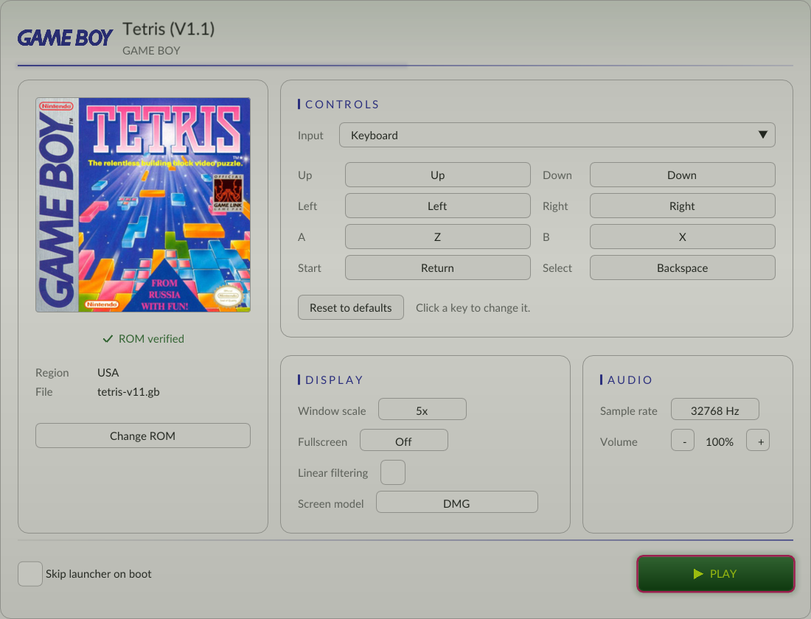

# TetrisGBRecomp para macOS

Recompilación estática de **Tetris (Game Boy)** a un ejecutable **nativo de macOS**.
Es un fork de [TetrisGBRecomp](docs/README-original.md) adaptado para Mac con
procesador **Intel**. El equipo de referencia es un **MacBook Pro 16" 2019**
(Core i9 de 8 núcleos a 2.3 GHz, Intel UHD Graphics 630).

> **¿Qué es esto?** No es un emulador. El código máquina original del Game Boy
> se **traduce a C** en tu Mac y luego se compila como un programa nativo. El
> resultado es un `Tetris` que corre directamente en macOS.

Soporta **dos versiones** del juego, que se pueden tener instaladas a la vez:

| Versión | Música A-TYPE | Archivo en `roms/` |
|---|---|---|
| **V1.1** — `Tetris (JUE) (V1.1) [!]` | **Korobeiniki** (la canción rusa clásica) | `tetris-v11.gb` |
| **V1.0** — `Tetris (World)` | Una melodía original distinta | `tetris.gb` |



---

## Índice

1. [Por qué hacía falta adaptarlo](#1-por-qué-hacía-falta-adaptarlo)
2. [Requisitos](#2-requisitos)
3. [Resumen rápido (para expertos)](#3-resumen-rápido-para-expertos)
4. [Guía paso a paso](#4-guía-paso-a-paso)
5. [El launcher](#5-el-launcher)
6. [Controles](#6-controles)
7. [Uso diario y actualizaciones](#7-uso-diario-y-actualizaciones)
8. [Afinar el rendimiento con `harvest.sh`](#8-afinar-el-rendimiento-con-harvestsh)
9. [Solución de problemas](#9-solución-de-problemas)
10. [Detalles técnicos](#10-detalles-técnicos)
11. [Cómo se probó](#11-cómo-se-probó)
12. [Estructura del repositorio](#12-estructura-del-repositorio)
13. [Créditos y licencias](#13-créditos-y-licencias)

---

## 1. Por qué hacía falta adaptarlo

El motor ([`gb-recompiled`](https://github.com/mstan/gbrecompiled)) y su
launcher ([`recomp-ui`](https://github.com/mstan/recomp-ui)) dibujan todo con
**OpenGL ES 2.0**. En Windows eso funciona porque se distribuye **ANGLE** junto
al `.exe`. Pero **macOS no incluye OpenGL ES**, solo OpenGL "de escritorio".
Sin cambios, el juego compilaría en Mac pero fallaría al abrir la ventana.

Este fork aplica dos parches (carpeta `macos/patches/`):

- **`gb-recompiled`**: en macOS usa **OpenGL 3.2 Core** y traduce los shaders a
  **GLSL 1.50**. Además corrige un fallo del motor por el que las flechas y
  `Return` no llegaban al juego.
- **`recomp-ui`**: launcher de **una sola pantalla** con la paleta del **Game Boy
  clásico (DMG)**. Los controles, la imagen y el sonido se cambian ahí mismo, sin
  submenús.

---

## 2. Requisitos

| Requisito | Detalle |
|---|---|
| Mac | Intel (x86_64). Probado como objetivo: MacBook Pro 16" 2019. |
| macOS | Una versión reciente que Homebrew siga soportando. Conviene tener tu Mac actualizado. |
| Espacio libre | ~1.5 GB (herramientas, código fuente y compilación). |
| Internet | Solo durante la instalación. |
| Herramientas | Xcode Command Line Tools y Homebrew. La guía explica cómo instalarlas. |
| **ROM** | **Tu propio volcado** de Tetris V1.1 y/o V1.0. **No se incluye** ni se descarga. |

### Las ROMs válidas

Basta con una de las dos; si tienes ambas, se compilan las dos.

| | **V1.1** (Korobeiniki) | **V1.0** |
|---|---|---|
| Nombre habitual | `Tetris (JUE) (V1.1) [!].gb` | `Tetris (World)` / `Tetris (W) (V1.0) [!].gb` |
| Tamaño | 32,768 bytes | 32,768 bytes |
| CRC32 | `46DF91AD` | `63F9407D` |
| SHA-1 | `74591cc9501af93873f9a5d3eb12da12c0723bbc` | `3f2a6407c9900ad5817ee1cfb3609c5ee17400fc` |

Las ROMs se reconocen por su **SHA-1**, no por el nombre del archivo. Cualquier
otra versión se ignora con un aviso.

---

## 3. Resumen rápido (para expertos)

```bash
xcode-select --install
```

```bash
git clone https://github.com/gabom88/TetrisGBRecomp-MAC.git
```

```bash
cd TetrisGBRecomp-MAC
```

```bash
./macos/setup.sh
```

```bash
mkdir -p roms && cp ~/Downloads/"Tetris (JUE) (V1.1) [!].gb" roms/
```

```bash
./macos/build.sh
```

```bash
./macos/run.sh
```

Se asume que Homebrew ya está instalado. Si no, sigue la guía completa.

---

## 4. Guía paso a paso

### Paso 0 — Abrir la Terminal

Pulsa `⌘ Cmd + Espacio`, escribe **Terminal** y pulsa `Return`. Todos los
comandos de esta guía se pegan ahí; ejecuta cada uno con `Return`.

> Cada bloque de código es **un solo comando**. Cópialos de uno en uno.

### Paso 1 — Instalar Xcode Command Line Tools

Son el compilador (Clang), `git`, `make` y `python3` de Apple.

```bash
xcode-select --install
```

- Aparecerá una ventana: pulsa **Instalar** y acepta la licencia (5–15 minutos).
- Si dice *"command line tools are already installed"*, ya los tienes: sigue al paso 2.

Comprobación (debe mostrar una ruta, sin errores):

```bash
xcode-select -p
```

### Paso 2 — Instalar Homebrew

Homebrew es el gestor de paquetes que instalará `cmake`, `ninja` y `SDL2`.

Comprueba si ya lo tienes:

```bash
brew --version
```

Si dice `command not found`, instálalo con el comando oficial de
[brew.sh](https://brew.sh):

```bash
/bin/bash -c "$(curl -fsSL https://raw.githubusercontent.com/Homebrew/install/HEAD/install.sh)"
```

Te pedirá tu contraseña de usuario de macOS (no se ve mientras la escribes; es
normal). En un Mac **Intel** Homebrew se instala en `/usr/local` y queda listo
para usar sin pasos extra. Cierra y vuelve a abrir la Terminal, y comprueba:

```bash
brew --version
```

### Paso 3 — Descargar este repositorio

Elige dónde guardarlo. Por ejemplo, en tu carpeta personal:

```bash
cd ~
```

```bash
git clone https://github.com/gabom88/TetrisGBRecomp-MAC.git
```

```bash
cd TetrisGBRecomp-MAC
```

> No hace falta `--recursive`: el script del paso 4 descarga las dependencias en
> la versión exacta que necesitan.

### Paso 4 — Preparar todo con `setup.sh` (solo la primera vez)

```bash
./macos/setup.sh
```

El script muestra el progreso en 5 pasos:

| Paso | Qué hace |
|---|---|
| 1/5 | Comprueba que existen Xcode Command Line Tools y Homebrew. |
| 2/5 | Instala con Homebrew **solo lo que falte** de `cmake`, `ninja` y `sdl2`. |
| 3/5 | Descarga `gb-recompiled` y `recomp-ui` **en los commits exactos** con los que se validó Tetris, dentro de este repo. |
| 4/5 | Aplica los dos parches (motor y launcher). |
| 5/5 | Compila el recompilador `gbrecomp`. |

Al final verás `==> Listo.` Puedes ejecutarlo otra vez sin riesgo: detecta lo
que ya está hecho y, si un parche cambió, lo actualiza.

> ⏳ **Mac Intel: el paso 2/5 puede tardar 15–40 minutos.** Homebrew ya no
> publica paquetes precompilados para Intel, así que **compila CMake y SDL2 en tu
> Mac**. Verás una línea como `==> ./bootstrap --prefix=/usr/local/Cellar/cmake/…`
> que parece congelada: **no lo está**. En el *Monitor de Actividad* verás
> procesos `clang`/`make` usando CPU. No cierres la Terminal.
>
> El aviso *"A newer Command Line Tools release is available"* es solo
> informativo; no impide la instalación.
>
> **Atajo opcional:** instala CMake con el `.dmg` oficial de
> [cmake.org/download](https://cmake.org/download/) (arrástralo a Aplicaciones y
> ejecuta `sudo "/Applications/CMake.app/Contents/bin/cmake-gui" --install`).
> Así `setup.sh` ve que ya existe `cmake` y no lo compila.

> Si responde `permission denied`, da permisos a los scripts con
> `chmod +x macos/*.sh` y repite.

### Paso 5 — Copiar tu ROM (o tus dos ROMs)

Crea la carpeta `roms/`. No viene en el repo porque las ROMs nunca se suben a
GitHub (`.gitignore`):

```bash
mkdir -p roms
```

Copia ahí tu ROM **con el nombre que tenga**. `build.sh` la identifica por su
SHA-1 y la copia al nombre interno que corresponde (`tetris-v11.gb` o
`tetris.gb`). Por ejemplo, desde Descargas:

```bash
cp ~/Downloads/"Tetris (JUE) (V1.1) [!].gb" roms/
```

También puedes arrastrarla con el Finder: abre la carpeta con `open roms`.

### Paso 6 — Recompilar y compilar con `build.sh`

```bash
./macos/build.sh
```

| Paso | Qué hace |
|---|---|
| 1/3 | Busca ROMs en `roms/` y reconoce cada versión por su SHA-1. |
| 2/3 | **Traduce la ROM a C**: `tetris-v11.toml` → `generated-v11/`, `tetris.toml` → `generated/`. |
| 3/3 | Compila con Clang y Ninja en modo Release con **OpenGL Core** (1–3 minutos por versión en un i9). |

Sin argumentos compila **todas** las versiones que encuentre. Para compilar solo
una:

```bash
./macos/build.sh v11
```

```bash
./macos/build.sh v10
```

Al terminar verás `==> Listo [V1.1]: generated-v11/build/Tetris`.

### Paso 7 — ¡Jugar!

```bash
./macos/run.sh
```

Arranca la V1.1 si está compilada (si no, la V1.0). Para elegir:

```bash
./macos/run.sh v11
```

```bash
./macos/run.sh v10
```

1. Se abre el **launcher**: título *Tetris (V1.1)* o *Tetris (V1.0)*.
2. La ROM ya aparece cargada y con **✓ ROM verified**: `build.sh` la deja
   apuntada. Si no, pulsa **Change ROM** y elige la de `roms/`.
3. Si quieres, cambia los controles o la imagen ahí mismo (ver [sección 5](#5-el-launcher)).
4. Pulsa **PLAY**.
5. En el juego: pulsa `Return` en el título. En **MUSIC TYPE** elige **A-TYPE**
   para Korobeiniki (en la V1.1) y confirma con `Return`.

> **Seguridad de macOS:** al compilarlo tú mismo, el programa no lleva la marca
> de "descargado de Internet", así que Gatekeeper normalmente **no** lo bloquea.
> Si macOS pregunta si el programa puede *aceptar conexiones entrantes*, puedes
> responder **Denegar**: es un servidor de depuración local (`127.0.0.1:4370`) que
> no hace falta para jugar.

---

## 5. El launcher

Todo está en una sola pantalla, con los colores del Game Boy clásico: carcasa
gris, botón PLAY en el verde de la pantalla y títulos en el azul del logotipo.

| Zona | Qué puedes hacer |
|---|---|
| **Tarjeta del juego** (izquierda) | Ver la carátula y si la ROM está verificada; **Change ROM**. |
| **CONTROLS** | **Input**: elegir teclado o un mando conectado. **Haz clic en cualquier tecla** (Up, Down, Left, Right, A, B, Start, Select) y pulsa la nueva; `Esc` cancela. **Reset to defaults** vuelve a las de fábrica. |
| **DISPLAY** | Escala de ventana, pantalla completa, suavizado y **Screen model**: los colores de pantalla (DMG verde, Pocket, Light, blanco y negro, ámbar, Super Game Boy). |
| **AUDIO** | Volumen. |
| **Skip launcher on boot** | Entra directo al juego las próximas veces. |

Los cambios se guardan al momento en `runtime_prefs.ini`, que el juego lee al
arrancar.

---

## 6. Controles

| Game Boy | Teclado del Mac | Alternativa |
|---|---|---|
| Cruceta | Flechas | `W` `A` `S` `D` |
| A | `Z` | `J` |
| B | `X` | `K` |
| Start | `Return` | — |
| Select | `Delete` (⌫) | `Shift` derecho |

| Atajo en el juego | Acción |
|---|---|
| `Esc` | Menú de ajustes (dentro: flechas para moverte, `Return` para elegir, `Esc` para volver). |
| `F1` | Overlay de información (FPS, audio). |
| `Tab` (mantener) | Turbo / avance rápido. |
| `F5` / `F8` | Guardar / cargar estado. |
| A + B + Start + Select | Reinicio del juego (función original de Tetris). |

> **MacBook Pro 16" 2019 con Touch Bar:** para pulsar `F1`/`F5`/`F8` mantén
> **`fn`**, o configura *Ajustes del Sistema → Teclado → Touch Bar muestra → Teclas F*.

Los mandos compatibles con SDL2 (PS4, PS5, Xbox, Switch Pro) deberían
detectarse y aparecer en **Input** del launcher.

---

## 7. Uso diario y actualizaciones

Para jugar, desde la carpeta del repo:

```bash
cd ~/TetrisGBRecomp-MAC
```

```bash
./macos/run.sh
```

### Crear un icono para el Escritorio (opcional)

Crea un archivo `.command` que se abre con doble clic:

```bash
printf '#!/bin/bash\nexec "%s/macos/run.sh" v11\n' "$PWD" > ~/Desktop/Tetris.command
```

```bash
chmod +x ~/Desktop/Tetris.command
```

### Actualizar el repo y recompilar

```bash
git pull
```

```bash
./macos/setup.sh
```

```bash
CLEAN=1 ./macos/build.sh
```

`CLEAN=1` borra las carpetas `generated*/` y regenera todo desde cero. También
reinicia los ajustes del launcher (controles, imagen) a los de fábrica.

### Variables opcionales de `build.sh`

| Variable | Efecto |
|---|---|
| `CLEAN=1` | Borra la carpeta generada antes de compilar. |
| `GAME_TOML=archivo.toml` | Compila una configuración arbitraria (modo experto). |

---

## 8. Afinar el rendimiento con `harvest.sh`

El recompilador traduce a código nativo todo lo que puede encontrar analizando
la ROM. Si al jugar el juego entra en una rutina que no encontró, **no pasa
nada**: esa parte la ejecuta un intérprete de respaldo (más lento, pero
correcto) y queda anotada en `interp_fallbacks.log`.

Con `harvest.sh` esas rutinas se incorporan y se recompila:

1. Juega un rato y **cierra el juego**.
2. Ejecuta (usa `v10` si jugaste la V1.0):

```bash
./macos/harvest.sh v11
```

3. Repite de vez en cuando. Cuando diga *"No había direcciones nuevas"*, ya está todo.

> El registro se reescribe en cada partida: ejecuta `harvest.sh` **después de
> cada sesión** que quieras aprovechar.

La V1.1 ya viene afinada: incluye **269 semillas** recogidas en varias partidas
de prueba (ver [sección 11](#11-cómo-se-probó)).

---

## 9. Solución de problemas

| Síntoma | Causa probable | Solución |
|---|---|---|
| `xcrun: error: invalid active developer path` | Faltan las Command Line Tools (a menudo tras actualizar macOS). | `xcode-select --install` |
| Se queda mucho tiempo en `==> ./bootstrap … cmake` | Homebrew compila CMake desde el código fuente (Mac Intel). | Espera (10–30 min) o usa el atajo del `.dmg` oficial del [paso 4](#paso-4--preparar-todo-con-setupsh-solo-la-primera-vez). |
| `brew: command not found` | Homebrew no está instalado o la Terminal no se reinició. | Paso 2 y abre una Terminal nueva. |
| `permission denied: ./macos/setup.sh` | Los scripts perdieron el permiso de ejecución. | `chmod +x macos/*.sh` |
| `No hay ninguna ROM reconocida en roms/` | La ROM no es V1.0 ni V1.1, o no está en `roms/`. | Comprueba con `shasum -a 1 roms/*` y compara con la [sección 2](#las-roms-válidas). |
| `(ignorada: … SHA-1 … no es V1.0 ni V1.1)` | Otra revisión, un hack o un volcado defectuoso. | Solo se admiten las dos versiones de la tabla. |
| `… no aplica sobre gb-recompiled` (o `recomp-ui`) | Se modificó a mano esa carpeta de forma incompatible. | Borra la carpeta (`rm -rf gb-recompiled` o `recomp-ui`) y repite `./macos/setup.sh`. |
| `Could not find a package configuration file provided by "SDL2"` | SDL2 no está instalado. | `brew install sdl2` y repite `./macos/build.sh`. |
| Ventana negra o `SDL_GL_CreateContext failed` | Los parches no se aplicaron (se pide OpenGL ES). | Repite `./macos/setup.sh` y luego `CLEAN=1 ./macos/build.sh`. Lee la línea `[GL] …` de la Terminal. |
| El launcher sigue negro, con *Settings* y *Configure* | Es una compilación anterior al parche del launcher. | `git pull`, `./macos/setup.sh` y `CLEAN=1 ./macos/build.sh`. |
| Las flechas y `Return` no hacen nada (pero `W` `A` `S` `D` sí) | Fallo del motor en la versión fijada. **Corregido en el parche.** | `git pull`, `./macos/setup.sh` y `CLEAN=1 ./macos/build.sh`. |
| Cambié los controles y ahora nada responde | Combinación rara guardada. | **Reset to defaults** en el launcher. |
| En A-TYPE no suena Korobeiniki | Estás jugando la V1.0. | `./macos/run.sh v11` (y compila la V1.1 si no lo hiciste). |
| El juego se ve algo suavizado en Retina | La ventana del juego no pide resolución HiDPI y macOS la escala. | Es solo estético. Desactiva *Linear filtering* en el launcher. |
| El launcher dice *No ROM loaded* | Moviste o renombraste la ROM después de compilar. | **Change ROM**, o borra `generated-v11/build/rom.cfg` y repite `./macos/build.sh`. |
| `F1`/`F5`/`F8` no hacen nada | La Touch Bar envía teclas de brillo o volumen. | Mantén `fn`. |

Para diagnosticar, la Terminal muestra al arrancar una línea como esta:

```
[GL] vendor=Intel Inc. | renderer=Intel(R) UHD Graphics 630 | version=4.1 INTEL-… | glsl=4.10 | shader_compiler=yes
```

Si ves `version=4.1`, se está usando OpenGL Core: eso es lo correcto en Mac.

---

## 10. Detalles técnicos

### Parche de `gb-recompiled` (`macos/patches/gb-recompiled-opengl-core.patch`, sobre `1ee1668`)

| Archivo | Cambio |
|---|---|
| `runtime/include/gbrt_gl.h` (nuevo) | Elige la cabecera GL: `<OpenGL/gl3.h>` en macOS y `SDL_opengles2.h` en el resto. |
| `runtime/CMakeLists.txt` | Opción `GBRT_GL_CORE` (**ON por defecto en Apple**). Con ella se dejan de definir `IMGUI_IMPL_OPENGL_ES2` y `LNG_GLES2`. |
| `runtime/src/platform_sdl.cpp` | Contexto **OpenGL 3.2 Core forward-compatible** e ImGui con `#version 150`. |
| `runtime/src/platform_sdl.cpp` (teclado) | Corrección de una versión posterior del motor: con el menú cerrado, flechas, `Return` y `Space` llegan al juego. |
| `runtime/src/shader_pipeline.cpp` | Reescribe los shaders `#version 100` a **GLSL 1.50** y crea un **VAO** (obligatorio en Core). |

### Parche de `recomp-ui` (`macos/patches/recomp-ui-dmg-launcher.patch`, sobre `44f549c`)

| Archivo | Cambio |
|---|---|
| `src/common/launcher_theme.h` | Tema `gb` claro con la paleta DMG: carcasa `#B9BAB3`/`#CDCEC7`, LCD `#0F380F` `#306230` `#9BBC0F`, logotipo `#2B2F7D` y botones A/B `#9B1D4D` como foco. |
| `src/common/backends/imgui/launcher_imgui.cpp` | Para los perfiles Game Boy (`gb`, `gbc`), un panel principal con **CONTROLS** editable (captura de teclas en línea), **DISPLAY** y **AUDIO**, sin el botón *Settings*. Además, el logotipo de la cabecera se tiñe en los temas claros. Las demás consolas no cambian. |

### Configuración de la V1.1 (`tetris-v11.toml`)

El código de la V1.1 está **desplazado** respecto a la V1.0: por ejemplo, la
copia de la rutina OAM-DMA a HRAM pasa de `0x0312` a `0x0293`. Por eso cada
dirección se leyó del propio código de la V1.1:

- **la rutina HRAM**, en `0x2A7F` (12 bytes);
- **los estados del juego**, de su tabla de saltos en `0x02FB`;
- **la interrupción serie**, desde su vector.

`extras.c` y `game_build.cmake` hacen que cada compilación acepte solo su ROM:
el CRC se elige según la carpeta `generated/` o `generated-v11/`.

Ni el código generado (`generated*/*.c`) ni el comportamiento del juego se
editan a mano.

---

## 11. Cómo se probó

Todo se validó en un entorno Linux, sin un Mac físico, con **Mesa en perfil
OpenGL Core**, que hace las mismas exigencias que macOS: sin GLES, sin GLSL ES y
con VAO obligatorio.

**Motor y gráficos**
- ✅ `gbrecomp` y el runtime parcheado compilan con **GCC** y con **Clang** (el compilador de macOS).
- ✅ El juego se dibuja a 59.7 FPS; los tres filtros de imagen compilan sin errores GL.
- ✅ Los scripts `setup.sh`, `build.sh`, `run.sh` y `harvest.sh` funcionan de principio a fin en una copia limpia.

**Teclado**
- ✅ Con una ROM de prueba propia que lee el mando, pulsando teclas reales, las 12
  teclas por defecto llegan al juego. Sin la corrección fallaban las flechas y
  `Return`, igual que en el Mac.
- ✅ Una tecla cambiada **desde el launcher** (A → J) funciona en el juego.

**Tetris V1.1**, con un volcado real, jugado de forma automatizada:
- ✅ Copyright, título, demo automática, menú de juego y música (A, B, C y OFF),
  partidas de Tipo A y Tipo B (con filas iniciales) hasta el game over, entrada
  de récord, pausa y reinicio A+B+Start+Select.
- ✅ Uso del intérprete de respaldo en una partida completa: de **31 millones** de
  instrucciones en la primera pasada a solo **6** en la verificación final, tras
  varias rondas de `harvest.sh` (269 semillas, incorporadas también esas 6). Si
  quedan más, estarán en rutas raras y se recogen jugando.
- ✅ Flujo completo en una copia limpia: `setup.sh` → ROM con su nombre original
  en `roms/` → `build.sh` → `run.sh` → launcher con la ROM verificada → PLAY → título.
- ⚠️ **No probado:** el modo **2 jugadores** (necesita cable link), la
  **música** (el entorno de pruebas no tiene audio) y la **V1.0** con los
  cambios de esta versión (no tengo esa ROM; su configuración no cambió).

> **Pendiente:** confirmarlo en el Mac real. Si algo falla, abre un *issue* con
> la salida completa de la Terminal, sobre todo la línea `[GL] …`.

---

## 12. Estructura del repositorio

| Ruta | Para qué sirve |
|---|---|
| `macos/setup.sh` | Instalación inicial: dependencias, motor fijado, parches y `gbrecomp`. |
| `macos/build.sh` | ROM → C → ejecutable nativo, para cada versión encontrada. |
| `macos/run.sh` | Arranca el juego (`v11` o `v10`) desde la carpeta correcta. |
| `macos/harvest.sh` | Incorpora las rutinas que se ejecutaron en el intérprete y recompila. |
| `macos/patches/` | Parches para `gb-recompiled` (OpenGL Core + teclado) y `recomp-ui` (launcher DMG). |
| `tetris-v11.toml` / `dispatch_misses-v11.toml` | Configuración y semillas de la **V1.1**. |
| `tetris.toml` / `dispatch_misses.toml` | Configuración y semillas de la **V1.0**. |
| `extras.c` + `game_build.cmake` | Identidad del juego: CRC y nombre según la versión. |
| `recomp/launcher/boxart.tga` | Carátula del launcher. |
| `docs/README-original.md` | README original del proyecto (Windows, en inglés). |

**No se versionan** (se generan o descargan): `gb-recompiled/`, `recomp-ui/`,
`generated/`, `generated-v11/` y `roms/`.

---

## 13. Créditos y licencias

- Proyecto original: **TetrisGBRecomp**, motor
  [**gb-recompiled**](https://github.com/mstan/gbrecompiled) y launcher
  [**recomp-ui**](https://github.com/mstan/recomp-ui), de **mstan** y colaboradores.
  Consulta el [README original](docs/README-original.md).
- Adaptación a macOS, soporte de la V1.1, launcher DMG, scripts y esta guía: este fork.
- *Tetris* es una marca de The Tetris Company. Este repositorio **no contiene ni
  distribuye** ROMs ni ningún otro material con copyright del juego. Necesitas
  volcados legales de tus propios cartuchos.
